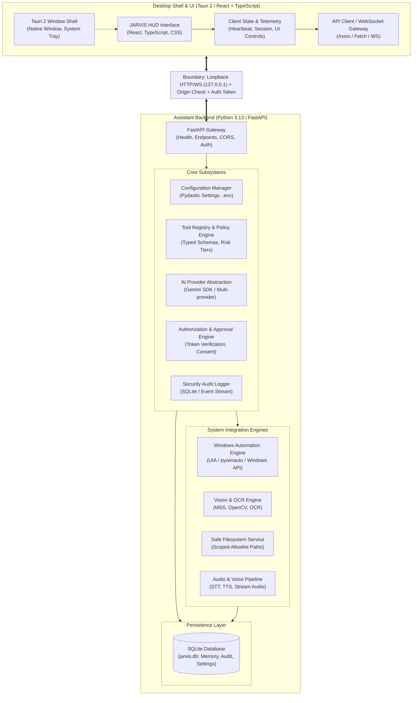
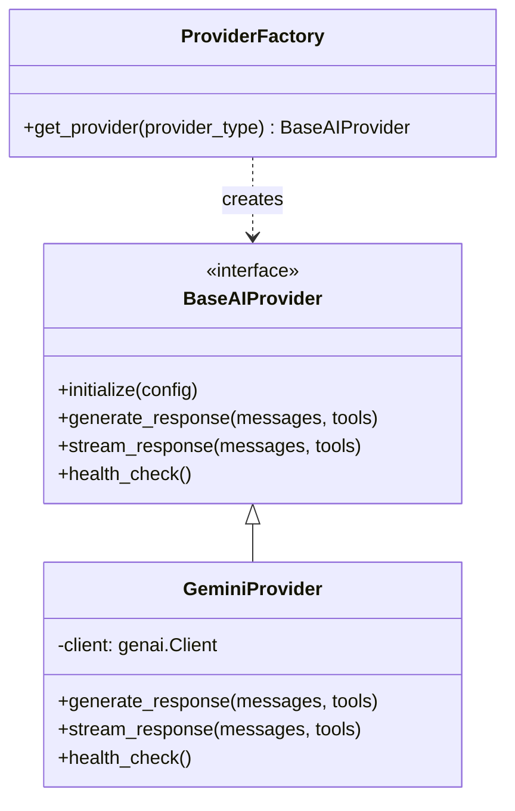

# JARVIS Desktop Assistant: Architecture Specification

## 1. System Overview

JARVIS (Just A Rather Very Intelligent System) is a modular, secure, and extensible Windows desktop AI assistant. Designed around a decoupled client-server architecture, JARVIS separates the visual human-interface display from privileged operating system automation and artificial intelligence providers.

The primary architectural goals are:
- **Strict Privilege Separation:** The frontend UI and AI model never execute raw operating system commands directly. Privileged actions are handled exclusively through a controlled backend with schema validation, permission checks, and audit logging.
- **Provider Agnostic AI Core:** An abstract AI provider interface allows seamless switching between Google Gemini and alternative providers while preserving conversational context and tool calling semantics.
- **Deterministic Action Pipeline:** All system modifications (filesystem, window management, process launching) pass through a typed tool registry with authorization boundaries, risk tiers, and user approval workflows.
- **Futuristic & Performant HUD:** A sleek, reactive user interface inspired by Marvel's Avengers with dark aesthetics, cyan/blue HUD motifs, real-time telemetry, and adjustable opacity.

---

## 2. High-Level Architecture Diagram



---

## 3. Component Breakdown

### 3.1 Desktop Shell & Presentation Layer
- **Architecture:** Native Windows 11 desktop shell via Windows Evergreen WebView2 (`pywebview` host in `scripts/desktop_app.py`) with support for Tauri 2 when Rust toolchain is available.
- **Window Modes & Presence:**
  - **Compact Floating Orb (Normal State):** Minimal, 96x96px holographic Arc Reactor orb floating over the Windows desktop with full alpha transparency (`frameless=True, transparent=True, on_top=True`). Wallpaper and background applications remain visible and accessible.
  - **Expanded Glass HUD (Expanded State):** Translucent glassmorphic panel (440x620px) with `backdrop-filter: blur(28px)`, real-time conversational streaming, task telemetry, and approval controls.
  - **Desktop Integration:** System Tray icon (`pystray`) for background persistence and a global system hotkey (`Alt + Space` / `Ctrl + Shift + J`) to summon or hide the assistant anywhere.
  - **Single-Instance Mutex:** OS-level named mutex (`Global\JARVIS_Desktop_Assistant_Singleton_Mutex`) ensuring one unified backend and frontend instance without port collisions.
- **JARVIS HUD Design System:**
  - Dark slate/black canvas (`#050a14`) with luminescent cyan accents (`#00e5ff`, `#0077be`).
  - Arc reactor telemetry widget with pulse and operational status indicators.
  - Scanline overlays, modular diagnostics panels, and selective opacity.
- **Client Responsibilities:**
  - Real-time connection monitoring with exponential-backoff health polling.
  - Streaming conversational interface with progress indicators for multi-step tasks.
  - Explicit interactive modal prompts when high-risk actions require user consent.

### 3.2 Backend Service (FastAPI)
- **Framework:** Python 3.13 running with FastAPI and Uvicorn.
- **Process Model:** Dedicated local service bound strictly to `127.0.0.1` (loopback only).
- **Core Endpoints:**
  - `/api/health`: System diagnostics, engine status, uptime, latency, and capability flags.
  - `/api/v1/chat`: Conversational streaming and reasoning loop.
  - `/api/v1/tools`: Tool registry catalog and parameter specifications.
  - `/api/v1/approvals`: Approval handshake for consequential action execution.
  - `/api/v1/system`: System telemetry (CPU, RAM, active windows, active monitors).

### 3.3 AI Provider Abstraction

- **Gemini Integration:** Leverages the official Google GenAI SDK.
- **Extensibility:** Interface supports drop-in replacement with local models (e.g., Ollama) or alternative cloud providers without altering downstream automation logic.

### 3.4 Tool Execution Engine & Risk Classification
All desktop capabilities are wrapped as validated tools inheriting from `BaseTool` (`backend/app/tools/base.py`):
- **Risk Tiers:**
  - `READ_ONLY`: Safe query/inspect operations (e.g. `windows_list_apps`, `windows_list_windows`, `ui_find_controls`). Auto-authorized without human confirmation.
  - `CONTROLLED`: Low-risk desktop operations (e.g. `windows_focus_window`, `windows_minimize_window`, `windows_launch_app` from strict allowlist, `ui_scroll`, `windows_open_folder`). Authorized automatically under standard policy.
  - `CONSEQUENTIAL`: Mutating desktop operations (e.g. `windows_close_window`, `ui_click_control`, `ui_set_text`, `ui_send_shortcut`). Require explicit human approval via the HUD approval gateway.
  - `CRITICAL`: System-altering operations (e.g. raw shell commands, process termination, unconstrained filesystem deletion). Blocked unconditionally by security policy.
- **Execution Pipeline:**
  1. Proposal: AI model or API client submits tool proposal with JSON arguments (`POST /api/v1/tools/propose`).
  2. Validation: Pydantic schema validator verifies parameter types, bounds, and required keys.
  3. Policy Evaluation: `PolicyEngine` checks risk tier, enforces path sandboxing against `JARVIS_ALLOWED_PATHS`, and formats human-readable action summaries.
  4. Approval Handshake: If `CONSEQUENTIAL`, an `ApprovalRequest` is generated with a 5-minute TTL and unique token. Frontend displays the action summary, parameters, and risk level.
  5. Bounded Execution: Upon approval, `ExecutionEngine` executes the tool under a bounded timeout (default 10s) with async cancellation support.
  6. Verification: Post-condition verification hook (`tool.verify`) inspects the outcome before returning status.
  7. Audit Logging: Complete operation details (proposal, approval decision, execution duration, verification outcome, errors) are committed to SQLite table `audit_logs`.

### 3.5 Automation & Subsystem Engines
- **Platform Adapter Architecture:** Abstract `PlatformAdapter` interface (`backend/app/automation/platform_adapter.py`) with:
  - `WindowsPlatformAdapter`: Uses `ctypes` (`User32`, `Kernel32`, `Shell32`) for window enumeration, focus, minimization, close signals, and child control inspection.
  - `MockPlatformAdapter`: In-memory simulated desktop environment enabling 100% hermetic unit and integration testing without side effects on the host machine.
- **Controlled UI Automation:** `backend/app/tools/ui.py` navigates accessible control trees (`EnumChildWindows`), allowing deterministic click, text entry, and allowlisted keyboard shortcuts (`ctrl+s`, `ctrl+c`, `tab`, `enter`, etc.) without blind screen coordinate guessing.
- **Safe Filesystem & App Launching:** Launching is constrained to a pre-approved application catalog (`DEFAULT_APPROVED_APPS`), and folder operations strictly enforce directory sandboxing within `workspace_path` and `JARVIS_ALLOWED_PATHS`.
- **Persistence:** SQLite manages short-term and long-term conversation memory, system settings, and immutable action audit trails (`audit_logs`).

### 3.6 Screen Perception, Local OCR & Multimodal Vision
- **Screen Capture Engine (`backend/app/perception/screen_capture.py`):**
  - High-performance, on-demand capture using MSS (`ScreenCaptureEngine`).
  - Full multi-monitor awareness: Monitor `0` captures the virtual combined desktop across all displays; monitors `1..N` capture specific physical monitors with DPI awareness.
  - Active window capture: Resolves the foreground window via Win32 `GetForegroundWindow()` and `GetWindowRect()`, auto-clipping bounds to the virtual desktop.
  - Windows Sandbox / Session isolation: Attached thread desktop switching (`OpenDesktopW("default")` / `SetThreadDesktop`) prevents `BitBlt` Win32 handle errors in background/daemon threads.
  - Privacy guarantee: No continuous recording, screen polling, or background capture. Capture runs strictly on-demand.
- **Local OCR Engine (`backend/app/perception/ocr_engine.py`):**
  - Native Windows Media OCR integration (`winocr` / Windows Runtime `Windows.Media.Ocr`).
  - Zero cloud dependencies for pure text reading: extracts visible text, line groupings, spatial bounding boxes (`x`, `y`, `width`, `height`), word count, and confidence scores locally on-device.
  - Preserves visual reading order across distinct screen regions.
- **Perception Tools & API Endpoints:**
  - `windows_capture_screen` (`READ_ONLY`): Captures active window or selected monitor; returns ephemeral base64 image data and metadata.
  - `windows_read_screen_text` (`READ_ONLY`): Performs local OCR and returns clean structured text without sending images to external models.
  - REST endpoints: `GET /api/v1/screen/monitors`, `POST /api/v1/screen/inspect`, `POST /api/v1/screen/ocr`.
- **Multimodal AI Provider Pipeline (`backend/app/providers/gemini.py`):**
  - `ChatContextMessage` extended with `image_data` (base64) and `image_mime_type`.
  - Google GenAI SDK multimodal integration via `types.Part.from_bytes(...)` alongside textual prompts.
  - Streaming conversational reasoning over screen context with real-time SSE chunking to the frontend HUD.

### 3.7 Approval Rejection & Failure Conversation UX
- **Rejection & Error Conversation Protocol:**
  - When tool execution fails, is declined, or security blocks an action, the backend returns a distinct, natural-language conversation message via `RespondApprovalResponse.conversation_message`.
  - Four distinct scenario templates:
    - **Scenario A (User Declined):** `"Understood. I've cancelled that action as requested. Nothing was changed."`
    - **Scenario B (Security Refusal):** `"I can't perform that action because it violates my security restrictions."`
    - **Scenario C (Execution Failure):** `"I attempted to perform the action, but Windows returned an error: ..."`
    - **Scenario D (Approval Expired):** `"The approval request expired before it was authorized. I haven't performed the action."`
  - Exactly-once semantics: Replay-protected token states ensure single-use authorization; frontend state transitions prevent duplicate chat events or duplicate system prompts.

### 3.8 Speech Processing & Voice Interaction Subsystem
- **Full-Response Neural Synthesis Strategy:**
  - Replaces sentence-by-sentence streaming TTS with full-response synthesis to eliminate unnatural pauses, fragmented cadence, and sentence-boundary audio artifacts.
  - While Gemini generates tokens, the HUD displays the live streaming text in real time.
  - Upon generation completion, the complete response is normalized through the speech normalizer and dispatched to the backend TTS provider in a single unified synthesis request.
  - Audio plays continuously as a single coherent stream without artificial queue delays or pauses.
- **Persistent Piper Neural Worker:**
  - A warm Piper ONNX subprocess (`piper_worker.py`) stays resident in background memory across requests, eliminating model load latency.
  - Supports dynamic timeout scaling and 64MB streaming buffers for synthesizing short, medium, and extended multi-paragraph responses (>1,000 words).
- **Speech Normalization & Prosody Profiles:**
  - Text normalization transforms markdown syntax, code snippets, numbers, dates, times, currencies, and technical acronyms into spoken form without altering the chat display text.
  - Delivery profiles (`relaxed`, `conversational`, `formal`) control phoneme length and noise scaling for human-like prosody.

### 3.9 Visual Computer Interaction & UI Automation Grounding (Phase 5)
- **UI Element Grounding Engine (`backend/app/perception/grounding.py`):**
  - Synthesizes structural controls (Win32 / Windows UI Automation via `EnumChildWindows`) with spatial OCR text lines (Windows Media OCR) into unified `GroundedUIElement` nodes.
  - Elements have verified bounding boxes, center coordinates, control types, interactability status, confidence scores, and parent window metadata.
  - Multi-tier fuzzy matching with query normalization, control type weighting, and spatial bounding.
  - Ambiguity rejection: If multiple top-tier candidates match with near-identical scores, `AmbiguousTargetError` is raised, prompting the operator for surrounding context rather than guessing.
  - Observation staleness check: Rejecting commands targeted at cached observations older than freshness threshold (5.0s).
- **Grounded Desktop Interaction Tools (`backend/app/tools/grounded_interaction.py`):**
  - `visual_locate_elements` (`READ_ONLY`): Scans and locates interactive UI elements matching a query without mutating desktop state.
  - `visual_click_element` (`CONSEQUENTIAL`): Resolves grounded target coordinates and executes verified single or double click. Requires user approval.
  - `visual_type_into_element` (`CONSEQUENTIAL`): Resolves text field, focuses it via grounded click, optionally clears existing content, and enters text. Requires user approval.
  - `visual_scroll_region` (`CONTROLLED`): Moves cursor to grounded element region and sends mouse wheel scroll pulses.
- **Bounded Debugging Screen Recording (`backend/app/perception/recording.py`):**
  - Records short desktop interactions to local animated GIF clips (`./recordings/`) for visual verification and debugging.
  - Strictly bounded duration (1 to 30 seconds) and framerate (1 to 15 FPS) with automatic timeout termination.
  - Zero external network exposure: recordings remain 100% on local disk.

### 3.10 Focus-Aware Grounded Clicking & Global Shortcut Approval (Phase 5.1)
- **Pixel-Accurate Win32 SendInput & Per-Monitor DPI V2:**
  - `WindowsPlatformAdapter` activates `SetProcessDpiAwarenessContext(-4)` (Per-Monitor V2) at initialization, ensuring desktop coordinates map 1:1 to MSS screen captures across arbitrary OS scaling (100%-250%).
  - Mouse clicks utilize `SendInput` with `MOUSEINPUT` normalized across `(x - v_left) * 65535 / v_width` with `MOUSEEVENTF_VIRTUALDESK | MOUSEEVENTF_ABSOLUTE`, supporting secondary monitors with negative coordinates.
- **Focus Verification & Input Leakage Guard:**
  - `restore_and_focus_window(handle, expected_pid)` restores minimized windows (`SW_RESTORE`) and activates target foreground focus using `AttachThreadInput` and `AllowSetForegroundWindow(-1)`.
  - Polling loop verifies `GetForegroundWindow() == handle` before input dispatch.
  - If target activation fails or J.A.R.V.I.S. remains foreground, `send_shortcut` aborts immediately with `FocusMismatchError`, eliminating keystroke leakage into the assistant UI.
- **Global Native Hotkey Approvals (`Ctrl + Alt + Y` / `Ctrl + Alt + N`):**
  - Registered via Win32 `RegisterHotKey` in `scripts/desktop_app.py`, allowing operators to approve or deny pending actions even when J.A.R.V.I.S. is backgrounded.
  - Backend endpoints `GET /api/v1/approvals/active` and `POST /api/v1/approvals/active/respond` provide atomic, single-call resolution with replay protection.
  - Desktop shell emits `jarvis:hotkey_decision` to frontend WebView2, automatically resuming multi-step task execution.

### 3.11 Modular Application Integration Framework (Phase 5.2)
- **Architecture Overview:**
  A unified integration manager (`ApplicationIntegrationManager`) operating over registered application manifests (`ApplicationManifest`), providing safe host OS discovery, capability routing, dual-provider orchestration, and 4-tier permission governance.
- **Ecosystem Manifests:**
  - **Browsers:** Opera GX (primary browser on host), Google Chrome, Chromium extensibility.
  - **Microsoft Office:** Word, Excel, PowerPoint, Outlook, OneNote, Access, Publisher.
  - **Messaging:** Discord, WhatsApp, Instagram (extensible to Telegram, Messenger).
- **Dual-Provider Architecture:**
  - `DesktopUIProvider`: Visual grounding, UIA control targeting, local OCR, coordinate clicking, typing, and window management.
  - `OfficeCOMProvider`: Native Win32 COM automation for Word, Excel, PowerPoint, and Outlook executed inside `asyncio.to_thread` with dedicated `pythoncom.CoInitialize()` and `CoUninitialize()` STA isolation.
  - `BrowserAutomationProvider`: Profiles for Opera GX and Chrome, URL navigation, tab management, readable page extraction, and untrusted data envelope tagging.
- **Centralized 4-Level Permission Tiers:**
  - Level 1 (Read-Only): Auto-permitted content inspection, window listing, OCR parsing.
  - Level 2 (Controlled): Non-destructive tab switching, search queries, draft preparation.
  - Level 3 (Consequential): Strictly approval-gated actions (send message, send email, overwrite files) with SHA-256 cryptographic parameter binding and replay protection.
  - Level 4 (Restricted): Hard-blocked actions (credentials, master passwords, payment forms).
- **Upstream Capacity Spike (503/429) Architecture:**
  - Multi-tier dynamic candidate failovers (`gemini-3.5-flash-lite`, `gemini-3-flash-preview`, `gemini-3.1-flash-lite`).
  - Schema sanitization removing unsupported JSON attributes (`additionalProperties`, `additional_properties`, `title`, `default`) preventing Gemini `400 INVALID_ARGUMENT` tool calling faults.
  - Offline local automation fallback: auto-detects launch, inspect, OCR, click, type, and capability intents and executes them locally during cloud outages.
  - In-character polite standby fallback for conversational prompts during cloud outages, returning assistant to `IDLE` state with zero crash.
  - Frontend `SERVICE_NOTICE` handling: non-blocking warning notice, sanitized error messages, and automatic state restoration.

---

## 4. Communication Protocol

### 4.1 REST & Streaming Endpoints
- **REST APIs:** Used for configuration, authentication, and health checks (`GET /api/health`, `GET /api/info`).
- **Server-Sent Events (SSE):** `POST /api/v1/chat/stream` for streaming conversational generation with the following event schema:
  - `message_start`: Emitted upon generation start.
    ```json
    { "event_type": "message_start", "request_id": "req-123", "session_id": "sess-456", "model": "gemini-2.5-flash" }
    ```
  - `text_delta`: Emitted as chunks arrive from upstream provider.
    ```json
    { "event_type": "text_delta", "request_id": "req-123", "delta": "Hello, Sir." }
    ```
  - `usage`: Emitted when token counts are available from provider.
    ```json
    { "event_type": "usage", "request_id": "req-123", "usage": { "input_tokens": 15, "output_tokens": 20, "total_tokens": 35 } }
    ```
  - `message_complete`: Emitted on stream completion with total duration.
    ```json
    { "event_type": "message_complete", "request_id": "req-123", "full_text": "...", "duration_ms": 340.5 }
    ```
  - `error`: Emitted if upstream failure or timeout occurs.
    ```json
    { "event_type": "error", "request_id": "req-123", "error_code": "UPSTREAM_TIMEOUT", "error_message": "..." }
    ```
- **Context Limits:** Server validates a maximum of 20 messages and 16,000 characters per conversation turn, with client-side session reset. Client disconnect cancels upstream processing.

### 4.2 Security Envelope
Every IPC request between frontend and backend includes:
- Verification of loopback origin (`localhost` / `127.0.0.1` / `tauri://localhost`).
- Optional shared secret session token generated during desktop shell startup.
- Request ID tracing for cross-referencing frontend actions with backend audit logs.

