# JARVIS Desktop Assistant: Implementation Roadmap

This document outlines the phased development roadmap for the JARVIS Windows Desktop Assistant. Work proceeds iteratively in strict phases. Later phases are not commenced until the acceptance criteria of preceding phases are verified and tested.

---

## Phase Overview

```mermaid
flowchart LR
    P0["Phase 0: Foundation & Core Comms"] --> P1["Phase 1: HUD UI & Theme"]
    P1 --> P2["Phase 2: Gemini AI Integration"]
    P2 --> P3["Phase 3: Tool Registry & Policy"]
    P3 --> P4["Phase 4: Windows Automation"]
    P4 --> P5["Phase 5: Vision & OCR Engine"]
    P5 --> P6["Phase 6: Voice Pipeline"]
    P6 --> P7["Phase 7: Memory & Workflows"]
    P7 --> P8["Phase 8: Packaging & Polish"]
```

---

## Phase Specifications

### Phase 0: Repository Foundation, Configuration, & Baseline IPC (Current)
- **Goal:** Establish repo structure, automated testing framework, dependency management via `uv` and `npm`, FastAPI backend with health diagnostics, React + TypeScript desktop shell, and bidirectional communication.
- **Deliverables:**
  - Standard repository layout (`backend/`, `frontend/`, `docs/`, `scripts/`).
  - Architecture, Roadmap, Security, and Status documentation.
  - Pydantic Settings configuration reading `.env` with validation.
  - FastAPI backend serving `/api/health` and `/api/info` with CORS and loopback binding.
  - React + TypeScript frontend with JARVIS HUD layout, connection heartbeat, and health telemetry.
  - Desktop shell configuration (Tauri 2 project scaffolding and local launcher).
  - Automated test suite (`pytest` for backend, type/build checks for frontend).
- **Acceptance Criteria:**
  - [x] Backend starts and responds with valid JSON on `GET /api/health`.
  - [x] Frontend successfully queries backend and displays real-time health and uptime.
  - [x] Backend test suite passes via `pytest`.
  - [x] Documentation accurately reflects local execution commands.

---

### Phase 1: JARVIS Futuristic HUD UI & Presentation System
- **Goal:** Implement the complete visual language of the JARVIS HUD.
- **Deliverables:**
  - Centerpiece animated Arc Reactor telemetry widget with dynamic operational states (idle, listening, thinking, executing).
  - Floating translucent panels with customizable grid layouts.
  - Windows acrylic / mica transparency and custom title bar controls.
  - Audio feedback cue framework (subtle sci-fi sound effects for state transitions).
  - Theme customization (Arc Cyan, Stark Gold, Tactical Amber, Stealth Monochrome).
- **Acceptance Criteria:**
  - HUD components render with fluid 60fps animations.
  - Transparency and drag controls function reliably across primary and secondary displays.

---

### Phase 2: Gemini AI Provider & Conversational Streaming
- **Goal:** Connect to the official Google Gemini SDK via a clean provider abstraction.
- **Deliverables:**
  - `BaseAIProvider` abstract class and `GeminiProvider` implementation.
  - Streaming SSE / WebSocket endpoint (`/api/v1/chat/stream`).
  - Conversation context memory buffer with token tracking.
  - Error handling for API rate limits, invalid keys, and network timeouts.
- **Acceptance Criteria:**
  - Model streams responses to the HUD in real time.
  - Simulated network drops recover cleanly without crashing frontend state.

---

### Phase 3: Typed Tool Registry, Execution Engine, & Authorization (Completed)
- **Goal:** Implement the controlled execution boundary preventing arbitrary LLM execution.
- **Deliverables:**
  - `BaseTool` class with strict Pydantic parameter schemas.
  - `ToolRegistry` with risk classification tiers (`READ_ONLY`, `CONTROLLED`, `CONSEQUENTIAL`, `CRITICAL`).
  - Interactive approval workflow in HUD for consequential/critical tools.
  - SQLite audit logger recording every tool proposal, approval, execution, and outcome.
- **Acceptance Criteria:**
  - [x] Consequential tools refuse execution without a cryptographically valid approval token.
  - [x] Audit log captures 100% of invoked actions with timestamps and parameters.
  - [x] 41 backend tests and 24 frontend tests passing.

---

### Phase 3.5: Native Desktop Shell & Floating HUD Realignment (Completed)
- **Goal:** Realize the native Windows 11 desktop presence: transparent floating orb, translucent glass HUD, system tray, and global hotkeys.
- **Deliverables:**
  - Native frameless transparent desktop host window using Windows 11 WebView2 (`scripts/desktop_app.py`).
  - Compact Floating Orb normal state: small draggable holographic Arc Reactor orb with true desktop transparency and status glow.
  - Expanded Translucent Glass HUD: non-intrusive glassmorphic interface with `backdrop-filter: blur`, conversational streaming, and Security Gateway for approvals.
  - Windows Taskbar System Tray icon (`pystray`) with quick access menu.
  - Windows global system hotkey (`Alt + Space` / `Ctrl + Shift + J`) to summon/hide JARVIS anywhere on the desktop.
  - Single-instance mutex lock (`CreateMutexW`) preventing duplicate processes and port 8000 collisions.
  - Live Windows 11 host smoke tests verified against real running desktop windows.
- **Acceptance Criteria:**
  - [x] App runs as a native desktop window without browser chrome, tabs, or Edge branding.
  - [x] Normal state renders as a compact floating transparent orb with visible desktop background.
  - [x] Window toggles smoothly between compact orb and expanded glass HUD.
  - [x] Minimizing / closing hides window to Windows System Tray.
  - [x] Global hotkey `Alt + Space` toggles assistant visibility across any active application.
  - [x] Real-world Windows smoke tests pass (44 backend tests green).

---

### Phase 4: Screen Perception, Multimodal Vision & OCR (Completed)
- **Goal:** Give JARVIS sight and visual reasoning capabilities with strict on-demand privacy, local OCR, and natural approval rejection feedback.
- **Deliverables:**
  - Multi-monitor screenshot capture using MSS (`ScreenCaptureEngine`) supporting all monitors, single monitors, and active foreground windows.
  - Local on-device OCR using native Windows 11 Media OCR (`winocr`) extracting text, reading order, lines, and spatial word bounding boxes.
  - Multimodal Vision reasoning via official Google GenAI SDK passing authorized screen captures to Gemini.
  - Privacy and consent gateway: explicit authorization required before sending images externally; pure local OCR for text-only queries; no continuous background recording.
  - Approval Rejection Conversation UX: Scenarios A (user rejection), B (security policy refusal), C (execution failure), and D (approval expiry) produce distinct natural-language conversation messages with exactly-once delivery.
  - HUD integration: `ScreenPerceptionModal.tsx` and in-bar controls for quick on-demand screen understanding.
- **Acceptance Criteria:**
  - [x] Test A (Screen understanding with multimodal reasoning) verified.
  - [x] Test B (Local OCR without cloud upload) verified.
  - [x] Test C (Ordinary chat never captures or uploads screenshots) verified.
  - [x] Test D (Approval rejection produces distinct cancellation message) verified.
  - [x] Test E (Multi-monitor capture and metadata enumeration) verified.
  - [x] 71 backend pytest tests and 30 frontend vitest tests passing.

---

### Phase 5: Advanced Visual Computer Interaction & UI Automation Grounding (Completed)
- **Goal:** Combine screen perception, OCR bounding boxes, and UI automation for reliable visual element targeting.
- **Deliverables:**
  - `UIElementGroundingEngine` (`backend/app/perception/grounding.py`): Real-time spatial fusion of Windows UI Automation (UIA) accessible controls and hardware-accelerated Windows Media OCR.
  - Multi-attribute control identification: buttons, text fields, search bars, checkboxes, radio buttons, menus, tabs, icons, and links.
  - Natural-language target fuzzy matching with type weighting, spatial disambiguation, and ambiguity rejection (`AmbiguousTargetError`).
  - Observation staleness validation ensuring interactions only execute against freshly observed screen states.
  - Grounded interaction tools: `visual_locate_elements` (`READ_ONLY`), `visual_click_element` (`CONSEQUENTIAL`), `visual_type_into_element` (`CONSEQUENTIAL`), and `visual_scroll_region` (`CONTROLLED`).
  - Native platform adapter enhancements (`WindowsPlatformAdapter`, `MockPlatformAdapter`): `click_at`, `type_text_at`, `scroll_at`, `get_window_bounds`.
  - Consequential policy enforcement with target coordinate pills and window context in HUD `ApprovalBubble.tsx`.
  - Interactive UI Element Grounding visualizer in `ScreenPerceptionModal.tsx` showing bounding boxes, element types, and click coordinates.
  - Bounded Screen Recording Service (`ScreenRecordingService`): Local animated GIF captures for interaction auditing and debugging (bounded to 1-30s @ 1-15fps, zero cloud uploads).
  - REST endpoints: `/v1/screen/elements/locate`, `/v1/screen/record/start`, `/v1/screen/record/stop`, `/v1/screen/record/status`, `/v1/screen/record/clips`.
- **Acceptance Criteria:**
  - [x] Assistant locates UI elements on screen by visual description and highlights target coordinates.
  - [x] Grounded target resolution rejects ambiguous queries and stale observations.
  - [x] Mutating actions (`visual_click_element`, `visual_type_into_element`) strictly bound to user approval policies.
  - [x] Screen recording bounded to local GIF exports with zero network leakage.
  - [x] 134 backend pytest tests and 86 frontend vitest tests passing with 0 errors.

---

### Phase 5.1: Grounded Clicking Repair & Focus-Aware Keyboard Approval (Completed)
- **Goal:** Repair physical mouse interaction on scaled multi-monitor setups and solve foreground window activation race conditions during keyboard approvals.
- **Deliverables:**
  - Per-Monitor V2 DPI Awareness (`SetProcessDpiAwarenessContext(-4)`) aligning Win32 coordinates directly with MSS physical screen captures.
  - Modern Win32 `SendInput` coordinate normalization (`MOUSEEVENTF_VIRTUALDESK | MOUSEEVENTF_ABSOLUTE`) spanning all virtual desktop boundaries, supporting secondary monitors with negative coordinates.
  - Focus-Aware Target Restoration: `restore_and_focus_window(handle, expected_pid)` with `AttachThreadInput`, `AllowSetForegroundWindow(-1)`, and polling verification loop.
  - Strict Focus Safeguards: Keystroke abort with `FocusMismatchError` if target window is not foregrounded, completely preventing input leakage into J.A.R.V.I.S.
  - Global Native Approval Shortcuts (`Ctrl + Alt + Y` for Approve, `Ctrl + Alt + N` for Deny) via `RegisterHotKey`, operating even when J.A.R.V.I.S. is backgrounded.
  - REST endpoints: `GET /api/v1/approvals/active` and `POST /api/v1/approvals/active/respond`.
  - Upgraded HUD `ApprovalBubble.tsx` displaying target application, window title, shortcut combinations, and hotkey badges.
  - 5-layer upstream capacity spike (503/429) fallback architecture with model failover and offline local tool execution.
- **Acceptance Criteria:**
  - [x] Grounded clicking moves cursor and dispatches clicks accurately without coordinate warping.
  - [x] Negative monitor coordinates accepted and validated across virtual desktop bounds.
  - [x] Keyboard shortcuts cannot be injected into J.A.R.V.I.S.; target window is verified foreground before input dispatch.
  - [x] Global shortcuts approve/deny active requests without mouse interaction.
  - [x] Multi-step tasks resume execution immediately upon hotkey approval.
  - [x] 149 backend pytest tests and 116 frontend vitest tests passing with 0 errors.

---

### Phase 5.2: Modular Application Integration Framework (Completed)
- **Goal:** Design and implement a modular framework allowing J.A.R.V.I.S. to discover, access, understand, and interact with applications on Windows 11 across Browsers, Microsoft Office, and Messaging.
- **Deliverables:**
  - Central `ApplicationIntegrationManager` (`backend/app/integrations/manager.py`): Discovery, capability catalog lookup, dual-provider orchestration, permission gating, and recent activity logging.
  - Manifest Catalog (`backend/app/integrations/registry.py`): Default manifests for Opera GX, Google Chrome, Microsoft Word, Excel, PowerPoint, Outlook, OneNote, Access, Publisher, Discord, WhatsApp, and Instagram.
  - Safe Discovery Engine (`backend/app/integrations/discovery.py`): Non-invasive registry scans (`HKCU`/`HKLM` `App Paths` and `Uninstall`), filesystem heuristics, active window enumeration, and safe process inspection via `psutil`.
  - Dual Provider System:
    * `DesktopUIProvider`: Visual grounding, UI Automation (UIA), OCR text extraction, coordinate clicking, typing, and window management.
    * `OfficeCOMProvider`: Native Win32 COM automation for Word, Excel, PowerPoint, and Outlook executed inside `asyncio.to_thread` with dedicated `pythoncom.CoInitialize()` and `CoUninitialize()` STA isolation.
    * `BrowserAutomationProvider`: Profiles for Opera GX and Chrome, URL navigation, tab management, readable page extraction, and untrusted data envelope tagging.
  - Centralized 4-Level Permission Tiers (`backend/app/integrations/permissions.py`):
    * Level 1 (Read-Only): Inspect documents, parse web pages, list windows (auto-permitted).
    * Level 2 (Controlled): Tab switching, search queries, draft preparation (policy-guided).
    * Level 3 (Consequential): Send message, send email, overwrite files (strictly approval-gated).
    * Level 4 (Restricted): Passwords, credentials, payment data (hard-blocked).
  - Cryptographic Approval Binding (`ActionApprovalBinding`): SHA-256 parameter hash binding approvals strictly to recipient, content, document path, and domain with replay protection.
  - Upstream 503 Capacity Spike Resilience: Dynamic candidate model failover (`gemini-3.5-flash-lite`, `gemini-3-flash-preview`, `gemini-3.1-flash-lite`), schema sanitization removing unsupported JSON attributes, offline local automation fallback, and in-character standby responses.
  - Frontend Application Management Modal (`frontend/src/components/ApplicationManagerModal.tsx`): HUD glass UI with category filtering, search, live discovery refresh, install/running/health status badges, capability breakdown, and granular permission toggles.
  - REST endpoints: `/api/v1/integrations/applications`, `/applications/{app_id}`, `/discover`, `/permissions`, `/activity`, `/execute`.
  - Core Tool Integration: `app_discover`, `app_list_capabilities`, and `app_execute_capability`.
- **Acceptance Criteria:**
  - [x] Host OS discovery identifies installed applications (Opera GX, Chrome, Word, Excel, PowerPoint, Discord) and running instances.
  - [x] Dual integration methods (Visual Desktop UI vs. Official COM/Automation) coexist without conflict.
  - [x] Consequential actions require operator approval with cryptographic SHA-256 parameter binding and replay protection.
  - [x] Upstream 503 / 429 capacity spikes fail over seamlessly without crashing the HUD stream.
  - [x] 170 backend pytest tests and 121 frontend vitest tests passing with 0 regressions.

---

### Phase 5.3: Visual Target Resolution & Reliable Clicking Redesign (Completed)
- **Goal:** Redesign the visual clicking pipeline so that natural-language targets (e.g. "Click on this video", "Open the second video", "Click search bar") are resolved to verified screen coordinates and window context BEFORE generating approval requests, with rock-solid physical clicking and upstream resilience.
- **Deliverables:**
  - Dedicated Visual Target Resolution Pipeline (`backend/app/perception/target_resolver.py`) with `ResolvedVisualTarget` model combining active window discovery, UIA, local OCR, multimodal Gemini Vision, and spatial heuristics.
  - Pre-approval resolution hook in `execution_engine.propose()` enriching parameters with concrete physical coordinates and rejecting unresolvable targets before approval generation.
  - Dual-channel mouse click execution (`windows_adapter.py`) using `SetCursorPos` with desktop attachment, hover settling, and dual dispatch (`SendInput` + `mouse_event`).
  - Target invalidation protection (`is_window_valid`) and post-click verification returning structured status.
  - Frontend approval cards (`ApprovalBubble.tsx`) displaying target description, application name, coordinates `(x, y)`, bounding box, confidence score, and detection badges.
  - Multi-layer upstream 503/429 demand spike resilience and candidate model failover (`gemini-flash-lite-latest`, `gemini-3-flash-preview`, `gemini-3.1-flash-lite`).
- **Acceptance Criteria:**
  - [x] Approvals are never generated for unresolved strings like "this video"; concrete coordinates and application bounds are verified beforehand.
  - [x] Real Windows GUI clicking moves the visible physical cursor and successfully triggers clicks across Win32, Tkinter, Chromium, and Electron controls.
  - [x] Invalidated or closed windows safely reject before click dispatch with `TARGET_INVALIDATED`.
  - [x] Upstream demand surges fail over seamlessly with exponential backoff and offline local desktop fallback.
  - [x] 176 backend pytest tests and 122 frontend vitest tests passing with 100% pass rate.

---

### Phase 6: Voice Pipeline & Multi-Step Task Planner
- **Goal:** Hands-free voice conversation and multi-stage task execution.
- **Deliverables:**
  - Audio capture service with voice activity detection (VAD).
  - Local or cloud speech-to-text (STT) and text-to-speech (TTS) with JARVIS voice modulation.
  - Multi-step task planner with cancellation tokens and real-time step progress reporting in HUD.
- **Acceptance Criteria:**
  - Voice query triggers end-to-end response and speech output.
  - User can cancel long-running multi-step tasks at any step via UI button or wake command.

---

### Phase 7: Persistent Memory, Workflows, & Customization
- **Goal:** User-controlled long-term memory and automated reusable workflows.
- **Deliverables:**
  - SQLite memory store for user facts, preferences, and system shortcuts.
  - Explicit user memory management UI (view, edit, delete memories).
  - Macro workflow builder (chain multiple tools into a single named routine).
- **Acceptance Criteria:**
  - Assistant recalls saved preferences across sessions.
  - User can inspect and wipe stored memories on demand.

---

### Phase 8: Hardening, Packaging, & End-to-End Evaluation
- **Goal:** Production release readiness and security evaluation.
- **Deliverables:**
  - Tauri 2 Windows installer (.msi / .exe) with auto-updater.
  - Comprehensive security penetration audit and prompt injection stress tests.
  - Automated end-to-end integration test suite.
- **Acceptance Criteria:**
  - Installer completes unattended setup.
  - Zero high-severity vulnerabilities in dependencies.

