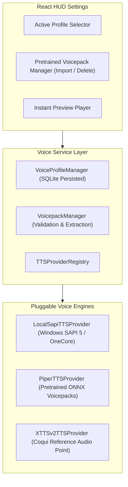

# J.A.R.V.I.S. Universal Voice Library Architecture & Guide

**Version**: Milestone 2.3  
**Status**: Production Ready  
**Compatibility**: Windows 11 x64, Python 3.13.10 (Host), Python 3.10.22 (`.venv_voice`)  

---

## 1. Overview

The J.A.R.V.I.S. Voice Library provides an extensible, provider-independent Text-to-Speech (TTS) architecture. Instead of hardcoding individual character engines or requiring lengthy user-side model training, J.A.R.V.I.S. manages ready-to-use pretrained voice models, downloadable voicepacks, and community-created ONNX models through a unified interface.



---

## 2. Supported TTS Providers

| Provider | Engine Type | Latency (CPU) | Offline? | Capabilities |
| :--- | :--- | :---: | :---: | :--- |
| **Windows SAPI 5** (`sapi5`) | COM / `pyttsx3` | **<50 ms** | 100% | Zero cloud dependencies; standard Windows system voices (David, Zira, Haruka); reliable universal fallback. |
| **Piper Neural TTS** (`piper`) | ONNX Runtime | **~200 ms** | 100% | High-speed neural voice synthesis from ready-to-use `.onnx` voicepacks. Supports custom imported community voicepacks. |
| **Coqui XTTS-v2** (`xtts-v2`) | Deep Learning | Variable | 100% | Reference audio voice cloning integration point. Isolated to prevent heavy dependency overhead at startup. |

> [!NOTE]
> **VOICEVOX**: In Milestone 2.3, the external VOICEVOX engine HTTP bridge was completely removed to focus exclusively on lightweight, on-device pretrained neural models and universal voicepack management.

---

## 3. Directory Structure & On-Disk Storage

Voice assets and models are organized under `data/models/`:

```
data/
├── jarvis.db                     # SQLite persistence (voice_profiles, system_settings)
└── models/
    ├── stt/                      # Faster-Whisper offline STT models (base.en, tiny.en, small.en)
    └── tts/
        └── piper/                # Installed Piper neural voicepacks
            ├── en_US-lessac-medium/
            │   ├── en_US-lessac-medium.onnx        # ONNX model tensors
            │   └── en_US-lessac-medium.onnx.json   # Model configuration & metadata
            └── <custom_voicepack_id>/
                ├── <voice_name>.onnx
                └── <voice_name>.onnx.json
```

---

## 4. How to Import Compatible Pretrained Voicepacks

### A. Supported Voicepack Format
A compatible voicepack archive is a standard `.zip` file containing:
1. **Model Checkpoint**: `<voice_name>.onnx`
2. **Configuration**: `<voice_name>.onnx.json` (or `<voice_name>.json`)

The `.onnx.json` configuration must specify:
```json
{
  "audio": {
    "sample_rate": 22050
  },
  "espeak": {
    "voice": "en-US"
  },
  "num_speakers": 1,
  "license": "CC-BY-4.0",
  "attribution": "Voicepack Creator"
}
```

### B. Importing via Frontend UI
1. Open the J.A.R.V.I.S. **Settings** modal (`Alt+S` or click Settings gear).
2. Under **Voice & Speech Subsystem**, navigate to **Pretrained Voicepacks**.
3. Click **"📁 Import Voicepack (.zip)"**.
4. Select the `.zip` archive on your computer.
5. J.A.R.V.I.S. will:
   - Validate paths against directory traversal (zip-slip defense).
   - Check file extensions against an approved security whitelist (`.onnx`, `.json`, `.txt`, `.md`).
   - Extract files atomically to `data/models/tts/piper/<voicepack_id>/`.
   - Index the voicepack and automatically register a selectable **Voice Profile**.

---

## 5. Security & Safety Guards

1. **Path Traversal Protection**: The import engine verifies that every archive member resolves strictly within the target voicepack sandbox directory using `Path.resolve()`. Any entry containing `..`, absolute paths, or escaping prefixes is rejected with a Security Violation error.
2. **Extension Whitelisting**: Only `.onnx`, `.json`, `.txt`, and `.md` are permitted. Executables (`.exe`, `.dll`, `.bat`, `.py`) are immediately rejected.
3. **Size Bounds**: Voicepack archives are capped at **500 MB** to prevent zip-bomb / resource exhaustion attacks.
4. **Isolated Inference**: Piper runs in the dedicated `.venv_voice` Python environment, preventing library conflicts with the primary Python 3.13 backend.

---

## 6. How to Add a Future TTS Provider

To add a new speech engine (e.g. MeloTTS, Sherpa-ONNX):
1. Subclass `BaseTTSProvider` in `backend/app/voice/tts/<new_provider>.py`:
   ```python
   from app.voice.tts.base import BaseTTSProvider

   class NewTTSProvider(BaseTTSProvider):
       @property
       def id(self) -> str:
           return "new-engine"

       @property
       def name(self) -> str:
           return "New Engine Display Name"

       def is_available(self) -> bool:
           ...
       def list_voices(self) -> List[VoiceInfo]:
           ...
       async def synthesize(self, request: SpeechSynthesizeRequest) -> SpeechSynthesizeResponse:
           ...
   ```
2. Register the provider in `backend/app/voice/tts/registry.py`:
   ```python
   self.register(NewTTSProvider())
   ```
3. The provider will automatically appear in UI telemetry badges and become available for voice profile assignment.

---

## 7. Known Limitations & Recommendations

- **Multi-Speaker Voicepacks**: Piper models with multi-speaker support enumerate each speaker index as `<voicepack_id>:<speaker_index>`.
- **Pitch Adjustment**: Windows SAPI and Piper models have fixed fundamental frequencies; rate (WPM) and volume adjustments are fully supported.
- **Hardware Profile**: Piper synthesis is optimized for CPU inference on Intel Core i7-1355U, consuming <200 MB RAM and completing in ~200 ms without thermal throttling.

